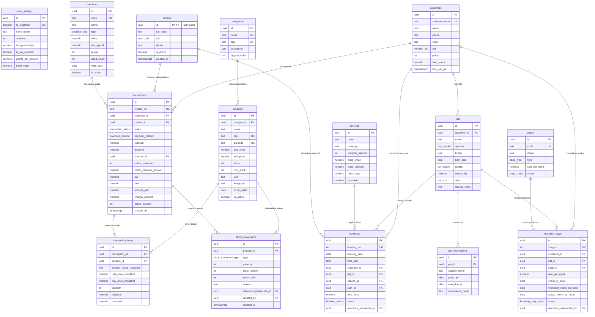

# Dokumentasi Skema Database PostgreSQL / Supabase - PawMart POS

Dokumen ini mendokumentasikan spesifikasi teknis arsitektur basis data, diagram relasi entitas (ERD), asumsi desain, dan pemetaan data dummy ke tabel Supabase.

---

## 1. Diagram Relasi Entitas (Entity Relationship Diagram)

---

## 2. Asumsi Teknis Desain Basis Data

Dalam perancangan skema ini, diambil beberapa keputusan teknis dan asumsi berikut:

1. **Format Finansial (`numeric(14,2)`):**
   * Seluruh nilai moneter (harga jual, harga beli, subtotal, diskon, pajak, total, kembalian) menggunakan `numeric(14,2)`.
   * *Alasan:* Mencegah *rounding error* yang sering terjadi pada tipe data *floating point* (`float`/`double`), serta mendukung nilai hingga puluhan miliar rupiah dengan presisi 2 desimal standar pembukuan akuntansi.

2. **Pelanggan Walk-In (Umum):**
   * Kolom `customer_id` pada tabel `transactions` bersifat nullable (`UUID NULL`).
   * Jika kasir bertransaksi dengan pembeli langsung tanpa pendaftaran member, `customer_id` bernilai `NULL`. Pada saat yang sama, data dummy memiliki entitas fallback `CUST-001` (Pelanggan Umum).

3. **Integritas Historis Finansial (Price Snapshotting):**
   * Tabel `transaction_items` mencatat snapshot nama produk (`product_name_snapshot`), harga jual saat transaksi (`unit_price_snapshot`), dan harga beli modal (`buy_price_snapshot`).
   * *Alasan:* Jika data master produk di kemudian hari mengalami kenaikan harga atau perubahan nama, laporan laba rugi dan cetak ulang struk historis tidak akan mengalami distorsi.

4. **Usia Hewan Peliharaan (`birth_date` vs Umur):**
   * Pada data dummy UI, umur tersimpan dalam format teks statis (misal `"2 Tahun"`). Pada skema PostgreSQL, disimpan kolom `birth_date DATE`.
   * *Alasan:* Umur anabul dapat dihitung secara dinamis (`AGE(CURRENT_DATE, birth_date)`) sehingga data tidak menjadi basi seiring berjalannya waktu.

5. **Pemisahan Hak Akses HPP Produk via RLS & View:**
   * Kasir dilarang melihat modal harga beli (`buy_price`). Untuk mengamankan ini di sisi API, disediakan view `v_products_public` yang mengecualikan kolom `buy_price`.

6. **Integritas Mutasi Stok Atomik:**
   * Seluruh pengurangan stok ritel dikunci di tingkat basis data menggunakan fungsi RPC `create_transaction` dengan klausa `SELECT ... FOR UPDATE`. Client frontend dilarang melakukan `INSERT` langsung ke tabel `transactions` atau `stock_movements`.

---

## 3. Tabel Pemetaan: File `/data` Dummy → Tabel Supabase

Gunakan tabel pemetaan ini saat melakukan integrasi kode frontend:

| File Dummy di `/data` | Tabel Supabase Terkait | Catatan Perubahan & Transformasi |
|---|---|---|
| `data/settings.ts` | `store_settings` | Objek `initialStoreProfile`, `ReceiptSettings`, `TaxSettings` disatukan ke dalam 1 baris tabel singleton. |
| `context/UserContext.tsx` & `data/staff.ts` | `profiles` & `auth.users` | Entitas `currentUser` dan `initialStaff` dipetakan ke `profiles` yang terikat dengan Supabase Auth UID. |
| `data/products.ts` (`categories`) | `categories` | Array string kategori diubah menjadi tabel referensi relasional berelasi ke produk. |
| `data/products.ts` (`initialProducts`) | `products` | Properti camelCase (`hargaBeli`, `hargaJual`, `stokMin`) diubah ke snake_case (`buy_price`, `sell_price`, `min_stock`). |
| `data/customers.ts` (`initialCustomers`) | `customers` | Data profil pemilik anabul, total belanja, dan poin member. |
| `data/customers.ts` (`pets`) | `pets` | Array anabul yang sebelumnya *nested* di pelanggan kini dinormalisasi ke tabel relasional terpisah ber-FK `customer_id`. |
| `data/customers.ts` (`vaksinTerakhir`, `jadwalVaksinBerikutnya`) | `pet_vaccinations` | Riwayat vaksinasi dinormalisasi ke tabel catatan medis dengan tanggal jatuh tempo (`next_due_at`). |
| `data/transactions.ts` (`initialTransactions`) | `transactions` & `transaction_items` | Header struk masuk ke `transactions`, array item barang masuk ke `transaction_items`. |
| `data/stockMutations.ts` | `stock_movements` | Log pergerakan stok fisik dengan referensi transaksi penjualan atau opname. |
| `data/loyalty.ts` (`initialVouchers`) | `vouchers` | Voucher kupon diskon kasir dengan batas kuota dan masa berlaku. |
| `data/services.ts` (`initialServices`) | `services` & `service_addons` | Katalog paket salon grooming dan tindakan medis hewan. |
| `data/boarding.ts` (`initialCages`) | `cages` | Daftar kamar inap dan kandang pet hotel berserta tarif per malam. |
| `data/bookings.ts` (`initialBookings`) | `bookings` | Reservasi antrean pengerjaan grooming dan konsultasi dokter hewan. |
| `data/boardingStays.ts` | `boarding_stays` | Pencatatan tamu inap, kontak darurat, dan durasi menginap di pet hotel. |

---

## 4. Hal-Hal yang Perlu Keputusan & Tahapan Selanjutnya

Berikut adalah beberapa hal yang direkomendasikan untuk keputusan lanjutan:

1. **Mekanisme Pendaftaran Akun Staf Pertama Kali:**
   * Saat ini, staf kasir/groomer dapat didaftarkan lewat Supabase Auth dashboard atau form admin. Perlu ditentukan apakah pembuatan akun staf di masa depan akan menggunakan email verifikasi atau *magic link*.
2. **Koneksi Integrasi Frontend (`@supabase/supabase-js`):**
   * Disarankan membuat client wrapper di `lib/supabaseClient.ts` untuk menggantikan pemanggilan array dummy `/data` secara bertahap dimulai dari modul Kasir POS dan Katalog Produk.
3. **Penyimpanan Gambar Produk:**
   * Di frontend saat ini gambar diunggah sebagai Base64 di `localStorage`. Saat migrasi ke Supabase, gunakan bucket `product-images` (dari migrasi `0006_storage.sql`) dan simpan public URL-nya ke kolom `products.image_url`.
