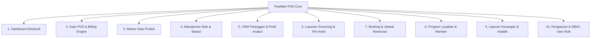
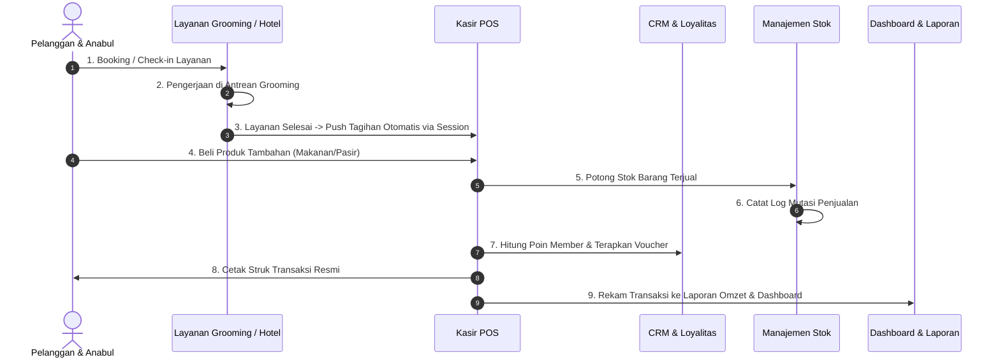

# Product Requirement Document (PRD): PawMart POS

**Aplikasi Point of Sale (POS) & Manajemen Operasional Pet Shop Modern**

* **Nama Proyek:** PawMart POS
* **Versi Dokumen:** 2.0 (Master Comprehensive PRD)
* **Tanggal Pembaruan:** 13 Oktober 2026
* **Status Proyek:** Active Development / Production-Ready Frontend with Local Persistence
* **Repository GitHub:** [https://github.com/Faliqulxx/PawMart](https://github.com/Faliqulxx/PawMart)

---

## 1. Ringkasan Eksekutif (Executive Summary)

**PawMart POS** adalah sistem aplikasi web kasir (*Point of Sale*) dan manajemen operasional terpadu yang dirancang khusus untuk memenuhi kebutuhan bisnis toko hewan peliharaan (*Pet Shop*), salon perawatan (*Pet Grooming*), klinik vaksinasi, dan penitipan hewan (*Pet Hotel / Boarding*).

Sistem ini memecahkan inefisiensi pencatatan manual dan sistem kasir konvensional yang sering kali memisahkan penjualan barang ritel dengan reservasi jasa perawatan. PawMart POS mengintegrasikan seluruh lini operasional: dari penjualan barang kasir, manajemen stok opname, CRM data pelanggan dan riwayat anabul, antrean layanan grooming, reservasi kamar pet hotel, sistem loyalitas member & voucher promo, hingga audit laporan laba rugi dalam satu dasbor yang responsif di desktop, tablet, dan smartphone.

---

## 2. Arsitektur Teknologi (Tech Stack)

| Komponen | Teknologi | Keterangan & Peran |
|---|---|---|
| **Framework** | Next.js 15+ (App Router) & React 19 | Server & Client Components modern, performa tinggi, dan routing modular |
| **Bahasa Pemrograman** | TypeScript (Strict Mode) | Keamanan tipe data end-to-end pada entitas data master |
| **Styling & Desain** | Tailwind CSS v4 & Lucide React | Desain hangat bernuansa pet shop (*Warm Orange & Cream Palette*) |
| **Visualisasi Data** | Recharts | Grafik batang dan lingkaran responsif untuk analitik penjualan |
| **State & Penyimpanan** | React Context (`UserContext`) + `localStorage` & `sessionStorage` | Sinkronisasi data real-time, persistensi gambar upload, dan interoperabilitas antar modul |
| **Pencetakan Struk** | Native Browser Isolated Print Iframe | Cetak struk termal format 58mm/80mm tanpa terpotong modal dialog |

---

## 3. Desain Sistem & Identitas Visual

Aplikasi mengusung identitas visual **Warm & Premium Pet Care** yang ramah anabul, bersih, dan modern:

* **Warna Primer (`#C9772E`):** Warna oranye hangat untuk tombol aksi utama, navigasi aktif, dan branding.
* **Warna Latar (`#F7F5F1` & `#FAF8F5`):** Latar krem lembut yang nyaman di mata untuk pemakaian kasir seharian.
* **Warna Kartu (`#FFFFFF` border `#ECE8E1`):** Kartu putih bersudut melengkung (*rounded-2xl*) dengan garis pembatas halus.
* **Tipografi:** Sans-serif modern (*Plus Jakarta Sans / Inter*) dengan ketebalan visual kontras.
* **Aset Gambar Bebas Emoji:** Seluruh produk, staf, dan kartu layanan menggunakan visual SVG/gambar riil berkualitas tinggi dengan komponen gambar pintar [`ProductImage.tsx`](file:///e:/PoS/PawMart%20POS/components/ui/ProductImage.tsx) yang memiliki penanganan *fallback* otomatis.

---

## 4. Modul & Fitur-Fitur Utama



### 4.1 Dashboard Eksekutif ([`app/(dashboard)/page.tsx`](file:///e:/PoS/PawMart%20POS/app/(dashboard)/page.tsx))
* **Metrik Real-time:** Menampilkan 4 kartu statistik utama: Total Penjualan Hari Ini, Jumlah Transaksi Kasir, Total Unit Produk Terjual, dan Peringatan Stok Menipis.
* **Grafik Tren Penjualan:** Visualisasi batang interaktif dengan filter dinamis (7 Hari Terakhir, 30 Hari Terakhir, dan Bulan Ini).
* **Widget Produk Terlaris:** Peringkat 5 produk paling laku dilengkapi visual gambar, kategori, unit terjual, dan omzet.
* **Daftar Transaksi Terkini:** Tabel transaksi langsung dengan status pembayaran dan tautan cepat ke cetak struk.
* **Akses Cepat Mobile:** Menu *quick grid* untuk perangkat smartphone guna mempercepat pembukaan kasir, antrean, dan pendaftaran booking.

### 4.2 Kasir POS & Billing Engine ([`app/(dashboard)/transaksi/page.tsx`](file:///e:/PoS/PawMart%20POS/app/(dashboard)/transaksi/page.tsx))
* **Dual-Panel Workspace:** Panel katalog pencarian produk (dengan filter chip kategori) di sebelah kiri, dan keranjang belanja aktif di sebelah kanan.
* **Penyesuaian Harga Khusus (Owner/Admin Discount):** Pemilik toko dapat menyesuaikan harga satuan item langsung dari keranjang untuk pelanggan khusus atau promo fleksibel.
* **Kalkulator Diskon & Pajak:** Dukungan diskon nominal (Rp), diskon persentase (%), diskon cepat kasir Rp 1.000, serta saklar PPN 11%.
* **Sistem Tahan & Lanjutkan Transaksi (*Hold Bill*):** Kasir dapat menahan transaksi pelanggan yang masih mengambil barang lain tanpa mengganggu antrean kasir lainnya.
* **Modal Pembayaran Multimetode:** Mendukung Tunai (dengan kalkulator kembalian otomatis), QRIS, Transfer Bank, dan Kartu Debit/Kredit.
* **Cetak Struk Termal:** Modal struk interaktif dengan tombol cetak langsung ke printer kasir format struk toko resmi via isolated iframe.

### 4.3 Master Data Katalog Produk ([`app/(dashboard)/produk/page.tsx`](file:///e:/PoS/PawMart%20POS/app/(dashboard)/produk/page.tsx))
* **Standarisasi 2 Produk per Kategori:** Memiliki 12 produk pilihan unggulan yang terbagi rata ke dalam 6 kategori:
  1. *Makanan Kucing:* Royal Canin Adult Cat 1kg, Whiskas Tuna Adult 1kg
  2. *Makanan Anjing:* Pedigree Adult Beef & Veg 1kg, Pro Plan Puppy Chicken Rice 2.5kg
  3. *Aksesoris:* Tempat Makan Stainless Anti-Semut, Mainan Kucing Laser & Bulu Interaktif
  4. *Pasir:* Pasir Kucing Bento Gumpal Apel 10L, Pasir Tofu Soya Kopi 7L
  5. *Obat & Vitamin:* Nutri-Plus Gel Virbac 120g, Minyak Ikan Salmon Omega 3 (100 Kapsul)
  6. *Kandang:* Kandang Kucing Besi Lipat 60x42x50cm, Pet Cargo Travel Box Ukuran M
* **Upload Foto Mandiri (*Custom Image Upload*):** Pengguna dapat mengunggah foto produk langsung dari file komputer/HP (JPG, PNG, WEBP, SVG hingga 5MB), menampilkan *live preview box*, atau menempelkan URL gambar eksternal.
* **Penyimpanan Gambar Persisten:** Foto yang diunggah dikonversi ke Base64 Data URL dan disimpan ke `localStorage` (`pawmart_products_v2`), sehingga langsung tampil sinkron di Kasir POS, Manajemen Stok, dan Laporan.
* **Audit & Filter Cepat:** Pencarian multi-parameter berdasarkan SKU, barcode, nama produk, kategori, dan status stok (Aman, Menipis, Habis).

### 4.4 Manajemen Stok & Mutasi ([`app/(dashboard)/stok/page.tsx`](file:///e:/PoS/PawMart%20POS/app/(dashboard)/stok/page.tsx))
* **Daftar Stok Real-time:** Menampilkan stok terkini, batas minimum (*buffer stock*), satuan kemasan, dan tanggal kedaluwarsa.
* **Early Expiry Alert:** Banner peringatan khusus untuk produk makanan atau obat-obatan yang mendekati tanggal kedaluwarsa.
* **Form Penyesuaian Stok (Stock Opname):** Form pencatatan Barang Masuk (+), Barang Keluar (-), atau Koreksi Fisik Opname lengkap dengan alasan (Pembelian, Retur, Rusak, Selisih Fisik).
* **Riwayat Mutasi Stok:** Audit log komprehensif mencatat tanggal, nama barang, pergeseran stok (Sebelum → Sesudah), dan nama petugas yang bertindak.

### 4.5 CRM Pelanggan & Rekam Medis Anabul ([`app/(dashboard)/pelanggan/page.tsx`](file:///e:/PoS/PawMart%20POS/app/(dashboard)/pelanggan/page.tsx))
* **Buku Kontak Pelanggan:** Database nomor WhatsApp, alamat, akumulasi poin loyalitas, total pengeluaran belanja (*lifetime spend*), dan tier status.
* **Kartu Identitas Anabul (*Pet Profile*):** Setiap pelanggan dapat memiliki beberapa profil hewan peliharaan (Nama anabul, spesies Kucing/Anjing, ras, jenis kelamin, usia, dan berat badan).
* **Jadwal Vaksinasi & Riwayat Perawatan:** Pengingat jadwal vaksin anabul berikutnya dan catatan alergi/kondisi kesehatan khusus sebelum tindakan salon grooming.

### 4.6 Layanan Jasa Grooming & Pet Hotel ([`app/(dashboard)/layanan/page.tsx`](file:///e:/PoS/PawMart%20POS/app/(dashboard)/layanan/page.tsx))
* **Katalog Jasa:** Menu paket grooming (Basic Mandi, Kutu & Jamur, Grooming Lengkap), penitipan harian/inap (Kamar Standard, Deluxe, VIP Room), dan layanan medis dokter hewan.
* **Papan Antrean Grooming (*Kanban Board*):** Memantau alur pengerjaan grooming dari status *Menunggu*, *Sedang Dikerjakan (In-Progress)*, hingga *Selesai*.
* **Manajemen Check-in & Check-out Pet Hotel:** Form registrasi kamar inap, nomor kontak darurat, titipan pakan, kalkulasi durasi menginap, serta tombol langsung **Check-out ke Kasir POS**.

### 4.7 Reservasi Jadwal & Booking ([`app/(dashboard)/booking/page.tsx`](file:///e:/PoS/PawMart%20POS/app/(dashboard)/booking/page.tsx))
* **Kalender Booking:** Memantau kapasitas layanan harian untuk mencegah *double booking* kapasitas meja grooming atau kamar hotel.
* **Form Reservasi Baru:** Pemilihan tanggal, time slot (misal: 09:00, 11:00, 14:00), pemilihan groomer/staf penanggung jawab, dan catatan khusus pelanggan.
* **Status Reservasi:** Konfirmasi, Selesai, Menunggu Kedatangan, atau Batal.

### 4.8 Program Loyalitas, Member Tier, & Voucher ([`app/(dashboard)/loyalitas/page.tsx`](file:///e:/PoS/PawMart%20POS/app/(dashboard)/loyalitas/page.tsx))
* **Tingkatan Member (Member Tiers):**
  * *Bronze:* Standar baru mendaftar (Multiplier Poin 1.0x).
  * *Silver:* Belanja > Rp 1.500.000 (Multiplier Poin 1.2x).
  * *Gold:* Belanja > Rp 3.000.000 (Multiplier Poin 1.5x + Promo Khusus).
  * *Platinum:* Belanja VIP > Rp 5.000.000 (Multiplier Poin 2.0x + Prioritas Grooming).
* **Poin Belanja Kasir:** Tiap pembelanjaan Rp 10.000 menghasilkan poin yang dapat dipotong langsung sebagai diskon kasir (1 poin = Rp 100).
* **Katalog Voucher Diskon:** Voucher diskon nominal atau persen yang dapat dipilih kasir di keranjang belanja dengan verifikasi minimum belanja.

### 4.9 Laporan Keuangan & Analitik ([`app/(dashboard)/laporan/page.tsx`](file:///e:/PoS/PawMart%20POS/app/(dashboard)/laporan/page.tsx))
* **Laporan Pendapatan Gabungan:** Memisahkan omzet penjualan produk ritel vs omzet jasa salon grooming & pet hotel.
* **Metrik Margin Keuntungan:** Perhitungan omzet, estimasi modal beli (HPP), dan estimasi laba kotor.
* **Komposisi Kategori & Kinerja Kasir:** Diagram kontribusi per kategori barang dan rekapan produktivitas staf salon/kasir.

### 4.10 Pengaturan & Role-Based Access Control / RBAC ([`app/(dashboard)/pengaturan/page.tsx`](file:///e:/PoS/PawMart%20POS/app/(dashboard)/pengaturan/page.tsx))
* **Sistem Peran Fleksibel (`UserContext.tsx`):**
  * **Owner (Pemilik Toko):** Akses penuh ke seluruh menu, laporan laba, manipulasi harga manual, dan manajemen staf.
  * **Admin:** Akses penuh operasional produk, stok, kasir, dan pelanggan.
  * **Kasir:** Akses fokus pada transaksi kasir, input booking, penukaran voucher, dan cek ketersediaan stok (tanpa akses edit HPP / ubah sistem).
  * **Groomer:** Akses khusus antrean grooming, checklist kondisi hewan, dan status pengerjaan anabul.
* **Konfigurasi Toko:** Profil outlet PawMart, alamat struk, nomor WhatsApp outlet, dan konfigurasi persentase pajak PPN.

---

## 5. Hubungan & Relasi Antar Fitur (Feature Relationships)

PawMart POS dibangun dengan filosofi **arsitektur terintegrasi**, di mana sebuah aksi pada satu modul secara otomatis memicu reaksi data pada modul lainnya:



### 5.1 Relasi Layanan Jasa ↔ Kasir POS
* Ketika layanan grooming selesai dikerjakan atau tamu anabul di Pet Hotel melakukan *Check-out*, staf cukup menekan tombol **"Selesaikan & Bayar"**.
* Sistem menyimpan paket jasa beserta harga ke `sessionStorage` (`pawmart_pending_service_checkout`) dan secara otomatis mengarahkan ke halaman Kasir POS.
* Kasir tidak perlu mengetik ulang harga jasa; item jasa langsung masuk ke keranjang belanja aktif lengkap dengan nama pelanggan yang terpilih.

### 5.2 Relasi Kasir POS ↔ Manajemen Stok & Mutasi
* Setiap transaksi penjualan produk ritel yang diselesaikan di Kasir POS akan mengurangi jumlah stok produk terkait di database lokal secara instan.
* Pengurangan stok mencatat entri otomatis pada **Riwayat Mutasi Stok** dengan jenis mutasi *"Keluar"* dan alasan *"Penjualan Kasir No. TRX-XXXX"*.
* Jika stok mencapai angka di bawah batas `stokMin`, sistem langsung menyalakan badge *"Stok Menipis"* pada Dashboard dan halaman Stok.

### 5.3 Relasi Kasir POS ↔ CRM Pelanggan & Program Loyalitas
* Kasir dapat memilih data pelanggan dari database CRM.
* Saat pelanggan dipilih, sistem membaca tier member (Bronze/Silver/Gold/Platinum) dan saldo poin yang dimiliki pelanggan.
* Pelanggan dapat menukarkan poin mereka untuk memotong total bayar kasir.
* Setelah transaksi selesai, nilai pembelanjaan baru diakumulasikan ke total belanja pelanggan (*lifetime spend*). Poin baru ditambahkan sesuai *multiplier tier*, dan sistem mengevaluasi kenaikan tier secara otomatis.

### 5.4 Relasi Master Produk (Foto & 2 per Kategori) ↔ Seluruh Modul
* Setiap penambahan, penghapusan, atau pengubahan produk dan foto di menu **Produk** langsung disimpan ke `localStorage` (`pawmart_products_v2`).
* Halaman Kasir POS ([`transaksi`](file:///e:/PoS/PawMart%20POS/app/(dashboard)/transaksi/page.tsx)), Manajemen Stok ([`stok`](file:///e:/PoS/PawMart%20POS/app/(dashboard)/stok/page.tsx)), Widget Dashboard ([`TopProducts.tsx`](file:///e:/PoS/PawMart%20POS/components/dashboard/TopProducts.tsx)), dan Laporan Penjualan langsung membaca data dan foto yang sama, memastikan data produk selalu konsisten di semua layar.

### 5.5 Relasi Role Access (RBAC) ↔ Antarmuka Pengguna
* Hak akses yang diatur pada `UserContext.tsx` secara proaktif menyaring komponen UI:
  * Kasir tidak dapat melihat modal harga beli produk (*HPP*) dan tidak dapat mengubah stok opname secara sepihak.
  * Hanya Owner/Admin yang memiliki akses tombol *Reset Default*, ubah harga khusus di keranjang kasir, dan pengaturan sistem toko.

---

## 6. Struktur Data Master (Data Schemas)

### 6.1 Skema Produk (`Product`)
```typescript
export interface Product {
  id: string;                      // Contoh: "PROD-001"
  nama: string;                    // Contoh: "Royal Canin Adult Cat 1kg"
  sku: string;                     // Contoh: "RC-CAT-01"
  barcode: string;                 // Barcode scan 10-13 digit
  kategori: "Makanan Kucing" | "Makanan Anjing" | "Aksesoris" | "Pasir" | "Obat & Vitamin" | "Kandang";
  hargaBeli: number;               // Harga pokok pembelian (HPP)
  hargaJual: number;               // Harga ritel kasir
  stok: number;                    // Kuantitas stok aktif
  stokMin: number;                 // Batas peringatan stok menipis
  satuan: string;                  // Pcs, Sak, Botol, Tube, Unit
  gambar?: string;                 // URL publik atau Data URL Base64 hasil upload mandiri
  icon?: string;                   // Alias kompatibilitas visual gambar
  tanggalKedaluwarsa?: string;     // Format YYYY-MM-DD
  deskripsi?: string;              // Keterangan spesifikasi produk
}
```

### 6.2 Skema Transaksi (`Transaction`)
```typescript
export interface TransactionItem {
  produkId: string;
  produkNama: string;
  harga: number;
  qty: number;
  subtotal: number;
  icon?: string;
}

export interface Transaction {
  id: string;                      // Contoh: "TRX-0018"
  noTransaksi: string;
  tanggal: string;                 // YYYY-MM-DD
  waktu: string;                   // HH:mm WIB
  pelangganId: string;
  pelangganNama: string;
  items: TransactionItem[];
  subtotal: number;
  diskon: number;
  pajak: number;
  total: number;
  metodeBayar: "Tunai" | "QRIS" | "Transfer" | "Kartu";
  nominalBayar: number;
  kembalian: number;
  status: "Selesai" | "Ditahan" | "Dibatalkan";
  kasir: string;
  catatan?: string;
}
```

### 6.3 Skema Pelanggan & Anabul (`Customer` & `Pet`)
```typescript
export interface Pet {
  id: string;
  nama: string;
  jenis: "Kucing" | "Anjing" | "Kelinci" | "Lainnya";
  ras: string;
  umur: string;
  beratKg: number;
  jadwalVaksinBerikutnya?: string;
}

export interface Customer {
  id: string;                      // Contoh: "CUST-001"
  nama: string;
  telepon: string;
  alamat?: string;
  totalBelanja: number;
  poin: number;
  tier: "Bronze" | "Silver" | "Gold" | "Platinum";
  pets: Pet[];
  kunjunganTerakhir: string;
}
```

---

## 7. Rencana Pengembangan Selanjutnya (Future Roadmap)

Meskipun saat ini antarmuka, alur relasi, dan persistensi lokal telah berfungsi penuh di sisi peramban, tahapan pengembangan berikutnya direncanakan mencakup:

1. **Integrasi Backend Database (Supabase / PostgreSQL):**
   * Migrasi skema TypeScript ke tabel relasional database dengan *Row Level Security (RLS)*.
   * Sinkronisasi data multi-kasir secara *real-time* via WebSocket Supabase.
2. **Cloud Media Storage (Supabase Storage / Cloudinary):**
   * Mengunggah file foto produk langsung ke bucket cloud CDN dengan kompresi otomatis untuk efisiensi penyimpanan.
3. **Hardware Bridge Kasir:**
   * Koneksi langsung ke printer thermal Bluetooth/ESC-POS dan laci uang (*Cash Drawer Trigger*).
   * Integrasi pemindai barcode fisik USB/Bluetooth via *HID keyboard emulation listener*.
4. **Notifikasi WhatsApp Otomatis:**
   * Pengiriman otomatis struk digital PDF dan pengingat jadwal vaksin/grooming ke nomor WhatsApp pelanggan.

---

## 8. Panduan Menjalankan Proyek (Local Setup)

1. **Clone Repository:**
   ```bash
   git clone https://github.com/Faliqulxx/PawMart.git
   cd PawMart
   ```
2. **Instalasi Dependensi:**
   ```bash
   npm install
   ```
3. **Jalankan Server Development:**
   ```bash
   npm run dev
   ```
4. **Buka di Browser:**
   Akses `http://localhost:3000` untuk membuka aplikasi PawMart POS.
